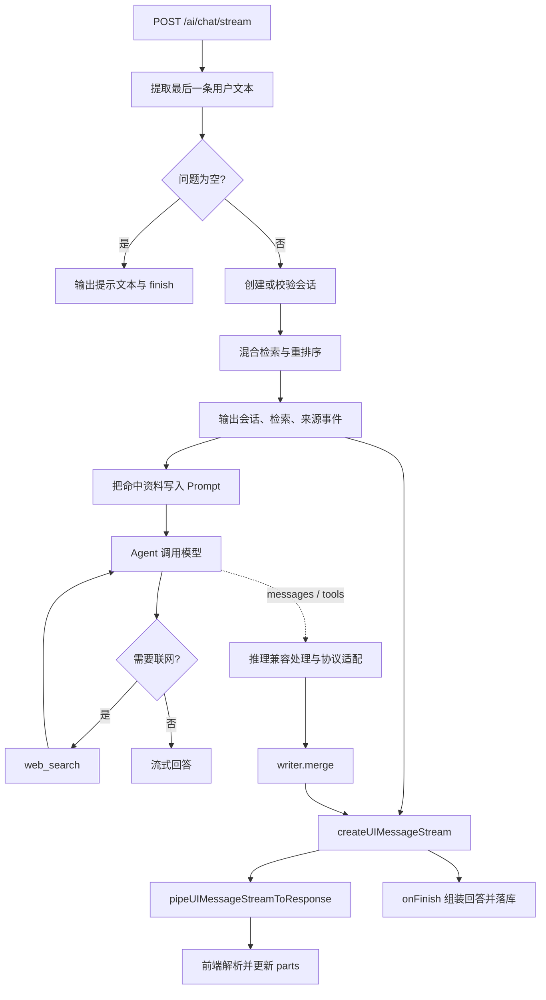

# streamChat 流式响应：代码、事件、协议与业务流程

本文针对 `packages/rag-hub-backend-2/src/ai/ai-stream.service.ts` 当前实现。核对的本地版本：`ai 7.0.138`、`@ai-sdk/langchain 3.0.138`、`langchain 1.5.16`、`@langchain/core 1.2.9`、`@langchain/openai 1.5.10`。这是代码阅读与模拟验证，不代表真实模型、数据库、Bocha 和代理服务的端到端验证。未修改业务实现。

## 1. 功能定位

`POST /ai/chat/stream` 完成一次 RAG 问答：创建或校验会话，先检索企业知识库，把资料写入提示词，再让 LangChain Agent 生成回答，并按需调用联网工具。回答、思考、工具事件、检索来源通过同一条 HTTP 响应流送给前端。流结束后提取回答和实际引用的知识库来源，保存问答。

这里存在三种不同的数据结构：

| 层 | 数据 | 用途 |
| --- | --- | --- |
| 模型与 Agent 层 | `AIMessageChunk`、LangGraph 事件元组 | 模型文本、推理片段、工具调用与结果 |
| UI 协议层 | `UIMessageChunk` | `text-delta`、`reasoning-delta`、`tool-*`、`data-*` 等结构化事件 |
| 网络传输层 | SSE 字符串和 UTF-8 字节 | 通过 HTTP 传输事件 |

`UIMessage` 是一条完整 UI 消息，`UIMessageChunk` 是改变这条消息的事件。前端持续应用事件，得到不断增长的 `UIMessage.parts`。



## 2. 逐段理解业务代码

### 105–110：取问题与保存本次请求状态

`lastUserText(dto.messages)` 从后向前寻找第一条 `role === 'user'` 的消息，把其文本 parts 拼接。它忽略之前的用户和助手消息；找到的最后一条用户消息即便没有文本，也直接返回空串。

`topK = dto.topK ?? 5` 在未指定时使用 5，表示最多使用多少个检索片段。`persistSessionId` 和 `persistSources` 是当前调用内的局部变量，被 `execute` 和 `onFinish` 两个闭包共享；它们不是 Service 单例上的共享请求状态。

### 114–129：建流、开始消息与空问题分支

`writer.write({ type: 'start' })` 开始一条 assistant UI 消息。本地 SDK 会在该事件没有 `messageId` 时注入生成的消息 ID。

空问题分支手动写出 `text-start → text-delta → text-end → finish`，不创建会话，也不保存问答。`id: 'empty'` 是文本块 ID，不是会话 ID。

### 131–148：会话与进度

已有 `sessionId` 时，`touchTitle` 按 `userId + sessionId` 查询所属会话，必要时更新默认标题并刷新时间。没有 ID 时创建会话。随后输出 `data-session`，使前端获知新 ID。

`data-status` 是作者自定义的 UI 数据事件，表示正在检索。SDK 不知道 `retrieve` 阶段意味着什么，需要前端自行渲染。这段代码只发出一次检索状态，没有后续“开始生成 / 完成”状态事件。

### 150–183：RAG 检索与来源事件

实际链路：问题 embedding → BM25 与向量 kNN 并行召回 → RRF 融合 → rerank → 分数过滤 → topK。

查询向量化失败会降级到关键词检索；外层检索整体失败会记日志，并继续使用空命中列表。检索失败和确实没有命中，在当前 UI 事件中都可能表现为空数组。

这一步是后端确定性执行的前置检索，不是由 Agent 决定是否调用的工具。

| 事件 | 内容 | 意义 |
| --- | --- | --- |
| `data-retrieve` | query、文档 ID、标题、heading、编号 | 展示检索行为及命中概要 |
| `data-sources` | 额外包含 excerpt、score 的来源数组 | 项目自定义引用面板数据 |
| `source-document` | 标准文档来源、sourceId、标题、媒体类型 | UI Message 协议的标准来源 part |

三者可以描述同一次检索的不同视图，不是三次检索。excerpt 最多取 200 个字符，提示词中每个片段最多取 800 个字符；这些长度不是 token 数。

### 185–203：检查模型并启动 Agent

未配置 Key 时写 `error` 与 `finish`。注意检查发生在会话和检索之后，因此仍可能已经创建会话和执行检索。

命中资料按 `[1]`、`[2]` 编号，并与问题组成一个 `HumanMessage`。系统提示词要求优先使用知识库、不足时调用 `web_search`，以及用 `[n]` 引用资料。

Agent 注册的 `web_search` 通过 Zod 定义工具输入，LangChain 负责调用后端函数。模型只生成工具名称和参数，真正的 Bocha HTTP 请求在服务端执行。`runLimit: 4` 限制一次 Agent run 中的模型调用次数，不是最多 4 个 token、4 个 HTTP 请求或严格最多 4 次工具调用。`exitBehavior: 'end'` 表示超限结束，不能保证已经生成理想的最终回答。

`streamMode: ['messages', 'tools']` 同时订阅模型消息片段与工具生命周期。常见事件形状如下，具体 metadata 从简：

```ts
['messages', [AIMessageChunk, metadata]]
['tools', {
  event: 'on_tool_start',
  name: 'web_search',
  toolCallId: 'call-1',
  input: { query: '最新政策' },
}]
['tools', {
  event: 'on_tool_end',
  name: 'web_search',
  toolCallId: 'call-1',
  output: { query: '最新政策', items: [] },
}]
```

带 namespace 的图流也可能是 `[namespace, mode, data]`。适配器解析这两种格式。`await agent.stream(...)` 获得流对象，不等于已经等待回答全部生成完毕；后续还要不断消费事件。

### 205–214：推理兼容、协议适配与合流

```ts
writer.merge(
  toUIMessageStream(mapReasoningStream(langchainStream) as never, {
    sendStart: false,
    sendFinish: false,
    onError: error => this.logger.warn(error.message),
  }) as never,
)
```

这段嵌套调用可拆为：

1. `mapReasoningStream` 对每条 LangChain 事件做百炼推理字段兼容。
2. `toUIMessageStream` 把 LangChain 事件转换成 AI SDK UI 事件。
3. `writer.merge` 持续读取转换后的子流，将事件注入外层 UI 流。

`toUIMessageStream` 来自 `@ai-sdk/langchain`，属于 AI SDK 的 LangChain 适配包；不是 LangChain 自带的前端协议，也不是直接向 Express 写字节的函数。它与其他 AI SDK API 中的同名或相似方法，需要按 import 来源区分。

`writer.merge()` 返回 void。外层 SDK 内部跟踪合流 Promise，因此 `execute` 返回以后，仍然等待子流结束才关闭外层流。如果合入多个流，事件可能交错；本实现只有一个 Agent 子流，且前置业务事件在 merge 前入队。

`sendStart: false` 合理：外层已经写过 `start`。`sendFinish: false` 的问题见第 7 节。

### 216–231：结束后的持久化

外层 SDK 按事件重建 assistant 消息，将其作为 `responseMessage` 交给回调。代码只取 `type === 'text'` 的 parts，拼接为 answer，再用 `/\[(\d+)\]/g` 提取引用编号，从 `persistSources` 过滤实际引用的来源。

例如检索命中 5 段，回答只含 `[2]`，数据库只保存第 2 段来源。没有 `[n]` 就保存空来源数组。前端已收到的候选来源，不等于最后落库的引用来源。

思考、工具参数、联网结构化结果、进度、完整 parts 都没有按原格式持久化。联网链接可以作为普通回答文本保存，但不进入这里的知识库来源数组。多个模型轮次的 text parts 会全部拼接，包括可能出现的中间说明。

落库失败仅记日志。用户看到文字，不代表问答一定保存成功。正常结束路径中 SDK 会等待这个异步回调，再完成下游流关闭，因此可能出现“文字已全部显示，连接仍在等待”的短暂状态。

## 3. createUIMessageStream 的语法与职责

```ts
const stream = createUIMessageStream<KhUIMessage>({
  execute: async ({ writer }) => {
    writer.write(/* 一条 UI 协议事件 */)
    writer.merge(/* 已经符合 UI 协议的子流 */)
  },
  onFinish: async ({ responseMessage }) => { /* 保存 */ },
  onError: error => /* 转换为客户端错误文本 */ String(error),
})
```

`<KhUIMessage>` 是 TypeScript 泛型参数，约束自定义 data 事件的类型，不是运行时校验器。`UIMessage<unknown, { status: ...; sources: ... }>` 的第二个泛型参数定义数据名，事件名对应 `data-status`、`data-sources`。第一个参数描述 metadata 类型，这里为 unknown。

`execute: async ({ writer }) => ...` 使用异步箭头函数与对象解构。调用 create 函数时就启动 execute，遇到 await 时让出执行，已入队的事件仍可被响应管道发送。不是先等 execute 完成，再开始发送。

本地 v7 源码中，`onFinish` 已标记为 `onEnd` 的弃用别名，但当前仍能使用。它是服务器回调，不是网络里的 `finish` 事件。

`as never` 只是强制类型断言，运行时会被擦除；它不会把流转换成另一种格式。本实现用它绕过了 `AsyncIterable<unknown>` 与适配器入参类型等检查，牺牲了编译期验证。

## 4. mapReasoningStream 为什么有效

```ts
async function* mapReasoningStream(stream: AsyncIterable<unknown>) {
  for await (const event of stream) {
    attachDashScopeReasoning(event)
    yield event
  }
}
```

`async function*` 声明异步生成器；`for await` 逐条等待上游事件；`yield` 将当前事件交给下游。它逐条变换，不会先收集完整答案。

百炼兼容接口的增量推理字段可能是：

```ts
additional_kwargs: { reasoning_content: '先分析资料' }
```

辅助函数补成适配器支持的形状：

```ts
additional_kwargs: {
  reasoning_content: '先分析资料',
  reasoning: {
    summary: [{ type: 'summary_text', text: '先分析资料' }],
  },
}
```

然后适配器输出 `reasoning-start / reasoning-delta / reasoning-end`，前端积累成 `type: 'reasoning'` 的 part。这是格式桥接，没有额外调用模型，也不是应用自己推导模型的内部思考。

辅助函数会原地修改对象，遍历数组及 `chunk / data / kwargs / messages` 字段；`seen` 防止循环引用。它不是遍历所有对象属性的通用深度扫描器。本地适配器也支持标准 reasoning/thinking content blocks，因此“只认 reasoning.summary”的注释并不完整。

`KhUIMessage` 中虽然声明 `think`，当前代码没有发送 `data-think`；实际思考走标准 `reasoning-*`。

## 5. 适配器具体转换了什么

| LangChain 数据 | UI Message 事件 | 重建后的 UI part |
| --- | --- | --- |
| 模型文本增量 | `text-start / text-delta / text-end` | `text` |
| 兼容后的推理增量 | `reasoning-start / reasoning-delta / reasoning-end` | `reasoning` |
| 工具参数生成 | `tool-input-start / tool-input-delta` | 生成中的工具 part |
| `tools.on_tool_start` | `tool-input-start / tool-input-available`，已有事件会去重 | 当前动态工具通常为 `dynamic-tool` |
| `tools.on_tool_end` | `tool-output-available` | 工具 part 的 output 与 state 更新 |
| `tools.on_tool_error` | `tool-output-error` | 工具 part 的错误状态 |
| 图执行 step 变化 | `start-step / finish-step` | step 边界；start 对应 `step-start` part |

工具调用通过 `toolCallId` 关联。工具输入片段不一定是完整 JSON，不能每拿到一个 delta 就当完整参数执行。工具在 LangChain 服务端执行；UI 事件用于观察其状态。

`WebSearchService` 在未配 Key、HTTP 失败等情形会返回 `{ error: ... }`，没有抛异常。适配器因此仍可能发送 `tool-output-available`：协议上函数已返回，业务上查询失败。前端若要区分，应检查 output.error。真正抛出的网络异常走错误路径。

## 6. 网络上的 SSE 长什么样

`pipeUIMessageStreamToResponse` 将 UI 事件 JSON 序列化，加上 SSE `data:` 和空行，再编码为 UTF-8 字节写入 Node/Express Response。

```text
HTTP/1.1 200 OK
Content-Type: text/event-stream
Cache-Control: no-cache
Connection: keep-alive
x-vercel-ai-ui-message-stream: v1
x-accel-buffering: no

data: {"type":"start","messageId":"assistant-1"}

data: {"type":"data-session","data":{"sessionId":"session-1"}}

data: {"type":"data-status","data":{"stage":"retrieve","text":"正在检索知识库…"}}

data: {"type":"text-start","id":"text-1"}

data: {"type":"text-delta","id":"text-1","delta":"可以申请"}

data: {"type":"text-delta","id":"text-1","delta":"年假。[1]"}

data: {"type":"text-end","id":"text-1"}

data: {"type":"finish"}

data: [DONE]

```

这是省略部分事件的规范化示意，`finish` 行当前正常 Agent 路径缺失，详见下节。

`start` 启动 assistant 消息；`text-start/end` 管一个文本块；`start-step/finish-step` 管 Agent 步骤；`finish` 表示消息完成；`[DONE]` 是 SSE 流结束标记，不是 JSON 事件。

TCP/HTTP 数据块不保证与 SSE 事件一一对应。一次 read 可能只有半个 JSON，也可能含多个事件；前端需用 SSE 解析器和流式文本解码，不能直接对每次网络 read 的结果执行 JSON.parse。

SSE 是响应格式，支持通过 fetch 发 POST 并读取响应。原生 EventSource 不能直接满足该接口的 POST JSON 请求需求。这里可用 AI SDK 的默认聊天传输，或自行实现符合协议的客户端。仓库检索未发现对应前端消费实现，不能假定已验证前端渲染。

`Connection: keep-alive` 不等于定时业务心跳。这次调用没设置 `keepAliveMs`；本地 SDK 只有传入该参数时才插入 SSE 保活注释。Node 写出函数支持 response.write 的 drain 背压，但中间 writer/适配器会主动读流入队，不能据此认定整条链完全按客户端速度限流。

## 7. 最重要的实际差异与边界

### 正常路径缺少 finish 事件

当前适配器 `sendFinish: false`，外层 execute 又没有在 Agent 子流结束后写 `finish`。检查本地 `create-ui-message-stream.ts` 和 `handle-ui-message-stream-finish.ts` 可见：它们关闭流、调用回调，但不自动补发 finish。

模拟实际结果：

```text
start → data-status → start-step → text-start
→ text-delta → text-delta → text-end → finish-step
hasFinish: false
callbackRan: true
outcome.status: unknown
```

这说明流关闭、onFinish 执行、finish 协议事件是不同概念。不能推断一定卡死，因为客户端仍可能依靠 EOF 收尾，但消息生命周期不完整。

对当前只有一个 Agent 子流的结构，成功路径最小调整建议是保留 `sendStart: false`，将 `sendFinish` 设为 true，由适配器正常结束时发 finish。本地模拟确认产生单个 start 与单个 finish。不能在 writer.merge 后立即 writer.write(finish)，因为 merge 不会阻塞，finish 会抢在模型文本前面。错误、取消和多个子流场景仍需单独设计，本文没有直接修改实现。

### 会话记录没有成为模型记忆

当前请求即使带完整历史 messages，模型只收到系统提示词和当前“资料 + 用户问题”这一条 HumanMessage；既没有加载历史问答，也没有配置会话 checkpointer/thread。sessionId 仅用于所属校验与落库。因此“刚才你提到的第二点”一类追问缺少上下文。若要支持多轮，需要显式加载或转换历史并管理上下文长度。

### onFinish 不等于成功

外层回调没有检查 outcome、取消状态或生成错误。无 Key 分支可能保存“未能生成回答。”；中途错误可能保存已经收到的半段文本。应按业务要求保存成功/失败/取消状态，并决定是否保留部分答案。

适配器的 onError 是通知回调，返回值不会替换客户端 errorText；适配器自己会输出原始错误文本。外层 create 的 onError 则用于把执行或合流异常转成错误文本，二者同名但职责不同。

### 取消与超时并没有完整接通

本地 HTTP 写出辅助函数在客户端断开时会取消响应流，外层 create 也有取消 reader 的逻辑。但这里没有把 AbortSignal 显式传给 Agent 或 Bocha fetch，而适配器消费 async iterator 的包装也没有完整的 cancel 传播实现。不能保证用户点停止后模型与搜索立即终止。

模型 timeout 不是整个请求的总超时：检索、最多多个模型调用、工具执行、落库都需要时间；Bocha fetch 没有显式 timeout。还需要考虑负载均衡和反向代理超时。

### 数据事件、引用与来源标识

这些 data 事件没有设置 transient，默认会进入 UIMessage.parts，但本项目落库只存纯文本和过滤后的知识库 sources，所以刷新后不能完整恢复进度与工具 UI。若状态只想临时展示，可用 transient；若想同一 part 持续更新，可用固定 id。

`source-document.sourceId` 目前使用 documentId；同一文档召回多个 chunk 时，多个编号可能共享一个 sourceId。若前端需要按片段独立定位，应设计 chunk 级标识。`[n]` 过滤只做字符串匹配，不验证引用是否真正支持回答，也不能自动覆盖 `[1,2]` 这类其他格式。

## 8. 重点记忆

1. `createUIMessageStream` 编排 UI 事件，`toUIMessageStream` 转换 Agent 事件，`pipeUIMessageStreamToResponse` 负责 SSE 编码与 HTTP 写出。
2. RAG 检索在 Agent 前固定执行，联网搜索由 Agent 按需调用。
3. 一个响应可以含多个文本块、推理块和工具状态，不是每个 token 都新增一条聊天消息。
4. writer.write 是事件，前端消费事件后才形成可渲染 UI；模型输出和网络字节需要中间转换。
5. execute 返回不代表子流完成；merge 不需要 await，也不能用 await merge 等待它完成。
6. finish、finish-step、onFinish、EOF 和 [DONE] 要分别理解。
7. 当前 session 是持久化归档，多轮上下文尚未接通。

## 9. 参考与验证

官方文档提供协议和 API 背景，具体行为以本地上述版本源码为准：

- [AI SDK createUIMessageStream](https://ai-sdk.dev/docs/reference/ai-sdk-ui/create-ui-message-stream)
- [AI SDK UI Stream Protocols](https://ai-sdk.dev/docs/ai-sdk-ui/stream-protocol)
- [AI SDK Streaming Custom Data](https://ai-sdk.dev/docs/ai-sdk-ui/streaming-data)
- [LangChain JavaScript Streaming](https://docs.langchain.com/oss/javascript/langchain/streaming)

本地重点源码：`ai/src/ui-message-stream/create-ui-message-stream.ts`、`handle-ui-message-stream-finish.ts`、`json-to-sse-transform-stream.ts`、`pipe-ui-message-stream-to-response.ts`、`ai/src/ui/process-ui-message-stream.ts`、`@ai-sdk/langchain/src/adapter.ts` 与 `utils.ts`。

运行了两组内存模拟：一组复现缺少 finish 但回调执行、text 增量合并和 data part 保留；另一组验证 reasoning、tools start/end 到 UI part 的转换，以及 sendFinish:true 的正常结束事件。没有发起真实问答或写入会话数据库。
